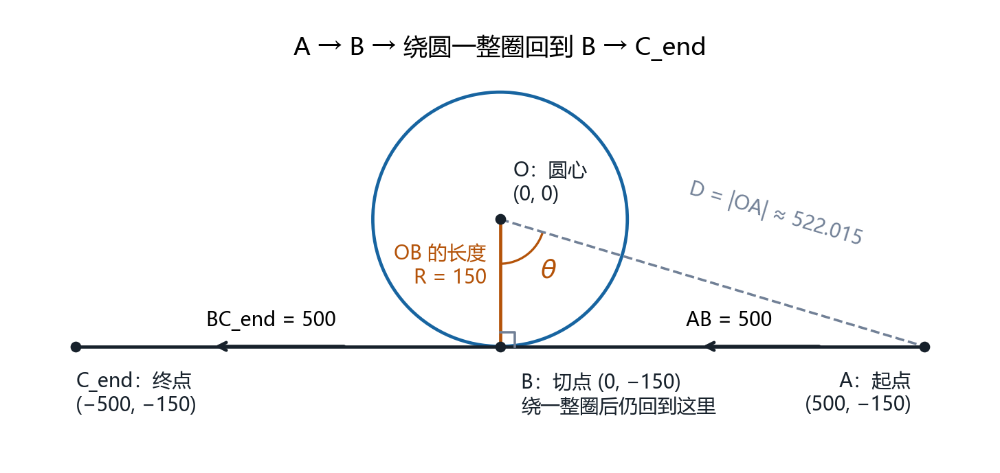

# 四次 B 样条轨迹与弧长插补（C11）

把“直线 AB → 整圆 → 直线 BC”的 Python 算法整理为独立 C 项目：按弧长采样生成控制点，搜索离散步长，构造四次 B 样条，以高斯–勒让德积分计算弧长，再用带区间保护的 Newton 法按目标弧长寻找下一插补点。

- [先看这里：六张图讲清几何、控制点、节点与弧长](docs/architecture.md)
- [实现细节：递推公式、Mermaid 流程图与 C API 对照](docs/implementation_details.md)
- [精度验证说明与实测结果](docs/precision.md)
- [机器可读精度报告](docs/precision_report.json)
- [C API](include/bspline.h) / [C 示例](examples/demo.c) / [Python 参考](python/reference.py)

第一次阅读建议从图解开始：每个缩写都有中文解释、类型和单位；另用六个控制点的小例子演算参数标签、节点数组和加权求值。



## 快速运行

C 核心只依赖 C11 标准库和数学库，无 NumPy/SciPy 运行依赖。

```sh
cmake -S . -B build -DCMAKE_BUILD_TYPE=Release
cmake --build build --config Release
ctest --test-dir build -C Release --output-on-failure
./build/bspline_demo
```

Windows 使用安装了 C 编译工具的 Visual Studio 2022，最后一行改为：

```powershell
.\build\Release\bspline_demo.exe
```

原始输入：`A=(500,-150), O=(0,0), R=150, branch=-1`，目标采样误差 `[0.04,0.05]`，初始 `d=20`。

实测输出（Linux / GCC 11.4 / double）：

```text
d: 5.625
actual step: 5.61409767652
control points: 347
sampled max error: 0.0439968414877
arc length: 1932.31997341
u0: 0.5
u1: 0.500618369079571
point: (-1.19998719257, 149.951429372)
requested length: 1.2
computed length: 1.2
```

## 圆周方向和输入

圆周方向完全沿用原 Python 的选择规则，随切点分支 `branch` 一起确定。程序提供普通输出和 JSON 输出：

```sh
./build/bspline_demo
./build/bspline_demo --json
```

自定义输入需同时给出九个数值参数：

```text
bspline_demo [--json] [Ax Ay Ox Oy R branch d_init err_min err_max]
```

示例：

```sh
./build/bspline_demo 500 -150 0 0 150 1 20 0.04 0.05
```

`branch` 的含义和结果保持原 Python 不变：本例 `branch=-1` 对应逆时针，`branch=+1` 对应另一切点及顺时针。库支持 1～16 次样条，示例及 Python 精度对照固定为四次。

## 在 C 程序中调用

```c
#include "bspline.h"

int main(void) {
    BsGeometry g;
    BsFit fit = {0};
    BsArc arc = {0};
    BsInverse next;
    BsStatus s = bs_geometry((BsPoint){500,-150}, (BsPoint){0,0},
                             150, -1, &g);
    if (s == BS_OK)
        s = bs_fit(&g, .04, .05, 20, 4, 1000, 60, 1e-5, &fit);
    if (s == BS_OK)
        s = bs_arc_init(&fit.curve, 1e-10, 4, 256, &arc);
    if (s == BS_OK)
        s = bs_inverse(&fit.curve, &arc, .5, 1.2, 1e-6, 100, &next);
    /* s == BS_OK 时，next.u 和 next.point 为下一插补参数与坐标。 */
    bs_arc_free(&arc);
    bs_fit_free(&fit);
    return s == BS_OK ? 0 : 1;
}
```

连续插补时复用同一个 `BsArc`，下一次将 `u0` 更新为 `next.u`。距离末端不足一个步长时，调用者可先通过 `bs_arc_length` 获得剩余弧长，再选择缩短末步或停止。

## 重现精度验证

推荐使用 Python 虚拟环境：

```sh
python3 -m venv .venv
. .venv/bin/activate
python -m pip install -r requirements-test.txt
python python/reference.py
python python/verify.py --exe build/bspline_demo --report docs/precision_report.json
```

Windows 将激活命令改为 `.venv\Scripts\Activate.ps1`，并指定 `--exe build/Release/bspline_demo.exe`。

已验证 10 组输入：与 Python 的曲线坐标最大分量差约 `1.64e-11`；与独立 QUADPACK 的总弧长最大差约 `7.28e-12`；120 次反求的最大独立弧长残差约 `8.03e-9`。这些是报告内输入的实测结果，完整判据与适用范围见[精度文档](docs/precision.md)。

可选绘图（需另外安装 `matplotlib`，图对应默认几何输入）：

```sh
python -m pip install matplotlib
python python/plot.py --exe build/bspline_demo --output trajectory.png
```

## 数值约定

1. 全程使用 `double`；坐标、距离和误差使用一致的物理单位，参数 `u` 无量纲。
2. 1000 点最大误差是采样最大值。误差定义是到**无限直线 AC 与整圆的并集**的距离，未约束运动相位。
3. `d` 搜索不是连续优化：控制点数由 `ceil(s_total/d)` 决定。目标区间不可达或迭代不收敛时返回 `BS_NOT_CONVERGED`，不把最后候选误报为成功。
4. 两阶高斯结果之差是误差估计，不是严格数学上界。C 实现在阶数达限后细分区间；仍无法满足判据时返回失败。
5. 所有拥有内存的输出结构先零初始化，使用后调用对应 `*_free`；已用结构作为新输出前先释放。手工构造的 `BsCurve` 必须提供有限、非递减且尺寸正确的节点向量，求值参数必须处于有效域内。`BsArc` 必须来自传给 `bs_inverse` 的同一条曲线；曲线改变后重新创建弧长对象。

本地验证环境为 WSL Ubuntu 22.04 / GCC 11.4。仓库内提供 Linux、Windows 的 CI 配置，其他平台的精度应以对应运行报告为准。

## 重现文档配图

安装 `requirements-docs.txt`，并准备 Microsoft YaHei 或 Noto Sans CJK 中文字体：

```sh
python -m pip install -r requirements-docs.txt
python tools/generate_doc_figures.py
```

脚本根据真实几何、样条和积分计算图示，输出 PNG、SVG 及教学例子数据到 `docs/images/`。教学粗采样图和六点例子都在文档中注明用途，与正式精度结果区分。
