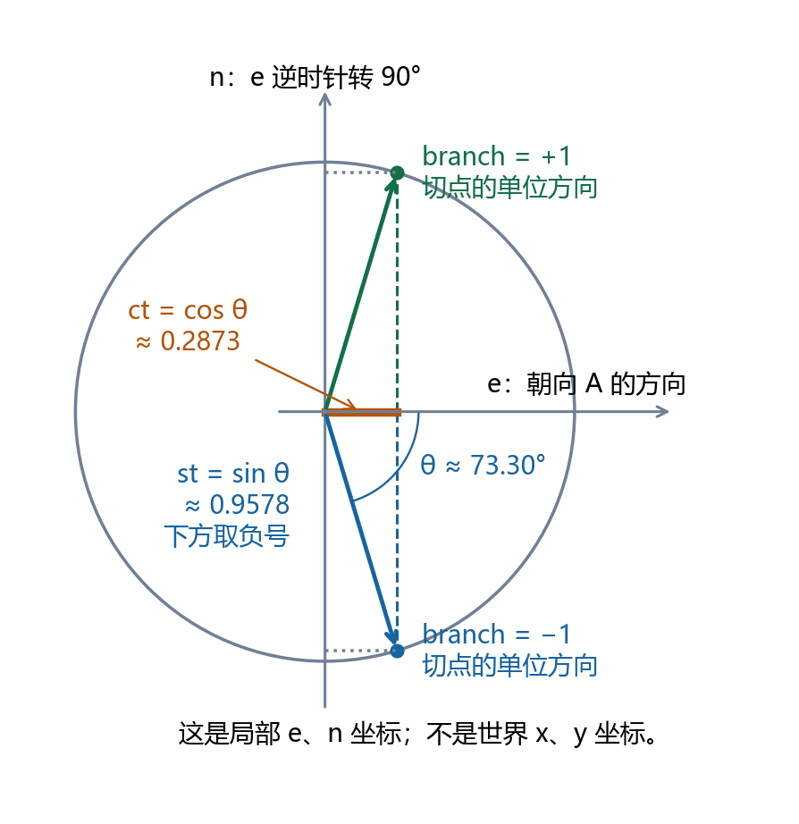
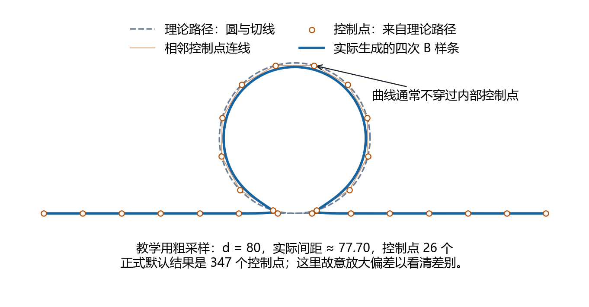
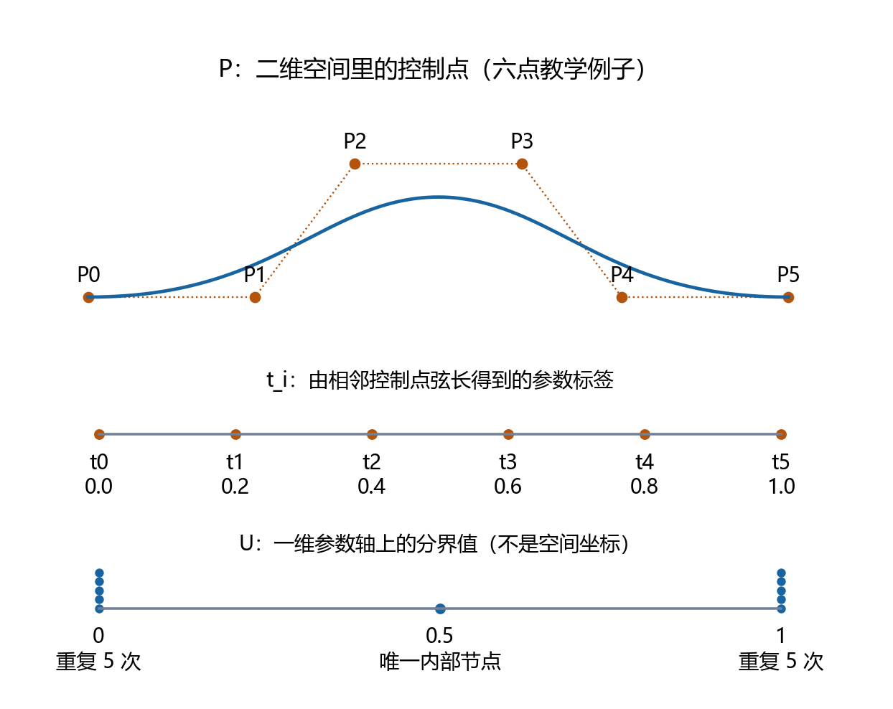
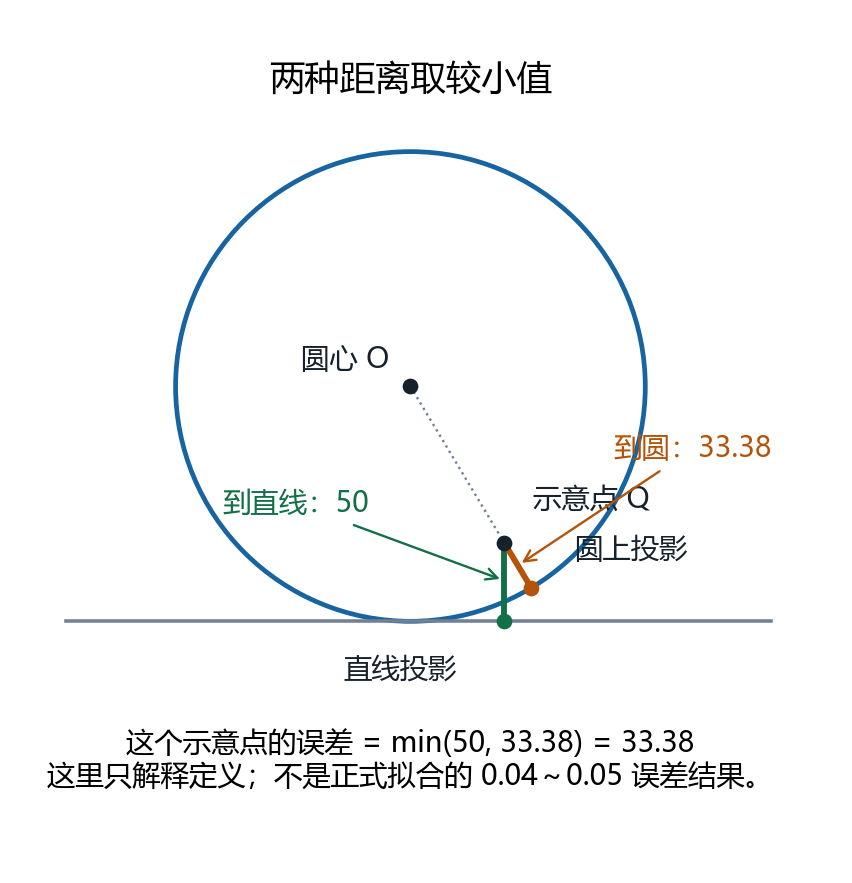
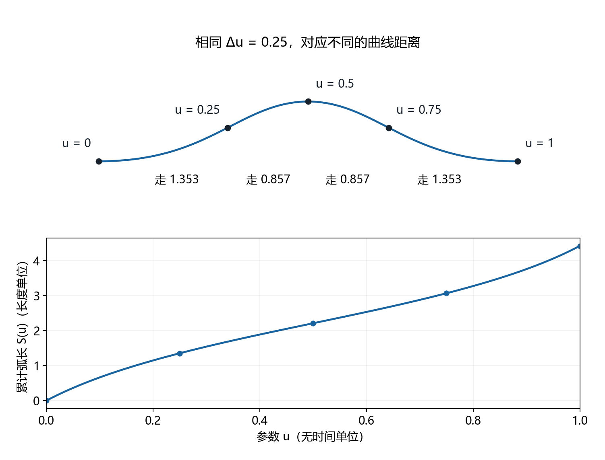
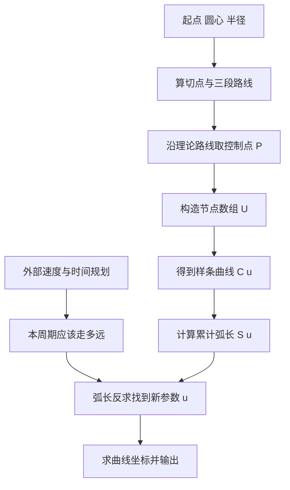

# 看图理解：切线圆路径怎样变成 B 样条，再按距离插补

这份文档先讲每个量表示什么，再讲计算步骤。无需先读 C/Python，也无需先记住节点公式。

阅读顺序：**看路线 → 找切点 → 取控制点 → 区分参数和节点 → 算坐标 → 量弧长 → 按距离找下一个位置**。数组下标、递推公式和缓存实现另见[实现细节](implementation_details.md)，实测数据见[精度报告](precision.md)。

## 1. 这条路径到底长什么样


图中使用原程序的实际输入。长度单位由调用者统一，以下用 mm 举例。

| 名称 | 代码符号 | 本例数值 | 含义 |
|---|---|---|---|
| 起点 | `A` | `(500,-150)` | 从这里开始走 |
| 圆心 | `O` | `(0,0)` | 圆的位置 |
| 半径 | `R` | `150` | 圆的大小 |
| 切点 | `B` | `(0,-150)` | 直线接触圆的位置，由程序算出 |
| 终点 | `C`，本文写作 `C_end` | `(-500,-150)` | 从 B 沿入射直线继续走相同长度 |

运动顺序分三段：

1. **A 沿直线到 B**，长度 500。
2. **从 B 绕圆一整圈，再回到 B**，长度约 942.478。
3. **B 沿直线继续到 C_end**，长度 500。

理论总长约 `1942.478`。B 会到达两次：累计走到 `s=500` 时第一次到 B，走到 `s≈1442.478` 时绕圆返回 B。**同一个空间坐标，不代表同一个路径进度。**

终点这样构造：A→B 的位移是 `B-A`，从 B 再走一遍相同位移，所以 `C_end=B+(B-A)`。

`C_end` 是一个固定终点；后面的 `C(u)` 是“输入参数，输出曲线坐标”的函数。原代码都用了 C，本文将它们分开写。

## 2. ct、st 从哪里来：看直角三角形

图中的 O、B、A 构成直角三角形，直角在 B，因为**圆的半径 OB 垂直于切线 AB**。

- 斜边 OA 的长度叫 `D`，约 `522.015`。
- 邻边 OB 的长度就是 `R=150`。
- O 点处、OA 与 OB 之间的夹角叫 `θ`（theta）。

由“邻边除以斜边”可得 `cos(θ)=OB/OA=R/D≈0.287348`，所以 `θ≈73.301°`。

| 原缩写 | 完整含义 | 中文读法 | 本例数值 |
|---|---|---|---:|
| `ct` | `cos_theta`，即 `cos(θ)` | 夹角的余弦 | `0.287348` |
| `st` | `sin_theta`，即 `sin(θ)` | 夹角的正弦 | `0.957826` |

两者都没有物理单位。代码用 `st=sqrt(1-ct²)`，来自 `sin²θ+cos²θ=1`。它们只是描述切点方向的两个比例。

## 3. e、n、rB 是什么：用两个方向拼出 OB



为了适用于任意 A、O，程序先建立两个参考方向：

1. **`e`：从 O 朝向 A 的单位方向。**“单位”表示长度等于 1，只保留朝向。本例约 `(0.957826,-0.287348)`。
2. **`n`：把 e 逆时针转 90° 的单位方向。**本例约 `(0.287348,0.957826)`。它是参考轴，不是 B 点的圆法线。

图2把 e 画成横轴、n 画成纵轴，以便看清投影。**这里是局部方向坐标，不是图1的世界 x/y 坐标。**

从 O 指向 B 的单位方向，可以这样拼出来：沿 e 取 `cos(θ)`，再沿 n 取正或负 `sin(θ)`。最后乘上半径 R，得到真正的位移：

**圆心到切点的位移 = R × (ct × e ± st × n)**。

正负号对应圆外一点的两条切线。`branch>=0` 取加号，`branch<0` 取减号。它决定选哪个切点，与绕圆方向是两回事。

原文档把这个位移叫 `rB`，即“B 点的径向向量”；C 代码叫 `radial`，原 Python 中是 `(px,py)`。更直白的读法是“圆心到切点的位移”。

| 名称 | 中文解释 | 类型与单位 | 计算或作用 |
|---|---|---|---|
| `A-O`，`(ux,uy)` | O 到 A 的位移 | 二维向量，mm | 求距离 D 和方向 e |
| `D` | O 到 A 的距离 | 一个长度，mm | `sqrt(ux²+uy²)` |
| `e`，`(ex,ey)` | O 朝向 A 的单位方向 | 二维向量，无单位 | `(A-O)/D` |
| `n`，`(nx,ny)` | 与 e 垂直的单位方向 | 二维向量，无单位 | `(-ey,ex)` |
| `rB` / `radial` / `(px,py)` | O 到 B 的位移 | 二维向量，mm | 由两个参考方向拼出 |
| `B` | 切点的世界坐标 | 一个点，mm | **圆心坐标 O + 位移 rB** |
| `AB`，`(ABx,ABy)` | A 到 B 的位移 | 二维向量，mm | `B-A`，也决定末段方向 |
| `theta0` | OB 相对世界 x 正方向的起始角 | 角度，rad | 从 B 开始画圆时使用 |
| `direction` | 圆周运动方向 | `+1` 或 `-1` | 正数逆时针，负数顺时针 |

**位移不等于世界坐标**：当 O 不在原点时，必须把 O 加回去才得到 B。本例 O 恰好是 `(0,0)`，二者数值才会一样。

本例取 `branch=-1`，计算得到 `rB≈(0,-150)`，所以 `B≈(0,-150)`。

### 切点分支与绕圆方向要分开理解

程序沿用原 Python 的规则，由选定的切点分支同时算出绕圆方向。本例 `branch=-1` 对应 B=(0,-150) 和逆时针；`branch=+1` 对应另一切点和顺时针。改变 `branch` 会同时改变切点与绕向，程序不另外提供独立的方向选择。

图1没有指定圆周箭头，只表达路线的几何和三段顺序。计算始终遵循原 Python 的 A→B→绕一整圈回到B→C_end。

## 4. 为什么还要取控制点



程序希望用**一条 B 样条近似直线加圆的组合路径**。所以先从理论路径上取一串点。

用累计路程 `s` 描述理论路径进度：0 在 A，500 第一次到 B，约 1442.478 绕圆回到 B，约 1942.478 到 C_end。

输入 `d` 是希望的采样间距。总长不一定整除 d，所以要先取整数段数，再调整实际间距。最终默认结果是：

1. 理论总长约 `1942.478`，搜索得到 `d=5.625`。
2. 向上取整，分成 **346 段**。
3. 实际间距 `d_actual=1942.478/346≈5.614098`。
4. 连同起点，共 **347 个点**，记作 `P_0..P_346`。

`P` 是这些二维点组成的数组，`P_i` 是第 i 个点。在本项目中，**采样点直接充当控制点**，没有再解一组插值方程。

控制点负责影响形状，曲线通常不穿过所有内部控制点。图中控制点在圆上，蓝色曲线却向内收缩，所以需要检查偏差。夹持构造只保证曲线通过首末控制点。

图3为了让差别可见，特意用 `d=80` 和 26 个控制点；**它不是满足0.04～0.05要求的最终曲线**。

沿圆均匀取点时，用的是弧长；下一步计算参数标签时，用的是相邻点的直线距离。两者不同，尤其跨越连接处时，不能把所有距离都当成同一个 d。

## 5. 控制点 P、标签 t_i、节点 U、查询参数 u 有什么区别



这里改用图4的 **6 个教学控制点**，以便完整列出数组。它用于解释样条，不是另一组切线圆拟合结果。

| 符号 | 它是什么 | 例子 |
|---|---|---|
| `P_i` | 二维空间里的控制点坐标 | `P_2=(1.6,0.8)` |
| `t_i` | 由控制点累计弦长得到的参数标签 | `t_2=0.4` |
| `U_j` | 节点数组中的参数分界值 | `U_5=0.5` |
| `u` | 这次查询曲线位置时输入的参数 | `u=0.25` |

`t_i` 不是时间，`U_j` 不是二维坐标，`u=0.25` 也不等于0.25秒或走过25%的弧长。

### 先给控制点贴标签 t_i

连接相邻控制点的直线段叫“弦”。每个标签等于：**从首点累计到当前点的弦长 ÷ 全部弦长之和**。

图4每条相邻弦恰好长1，共5条，所以：

```text
控制点：P0    P1    P2    P3    P4    P5
标签：  0     0.2   0.4   0.6   0.8   1
```

间距不等时，标签也不会均匀。**贴标签只是帮助构造节点数组，不保证曲线在 u=t_i 时经过 P_i。**

### 再由标签生成节点数组 U

U 可以理解为**参数轴上的分界清单**：样条在不同节点区间内使用多项式片段，再按样条规则拼接；它也参与决定控制点在某个参数处的影响权重。

图4为四次样条，`p=4`，首尾各重复 `p+1=5` 次。六点例子只需要一个内部节点，由四个标签求平均：

`(0.2+0.4+0.6+0.8)/4=0.5`。

因此得到：

```text
U = [0, 0, 0, 0, 0,  0.5,  1, 1, 1, 1, 1]
     起点重复5次      内部   终点重复5次
```

有效域有两个非零区间：`[0,0.5]` 与 `[0.5,1]`。首尾重复是“夹持”构造的一部分，让曲线通过首末控制点；**不是停五次，也不是在空间里再放五个点**。

节点数组长度是“控制点数量 + 次数 + 1”：教学例子 `6+4+1=11`，正式默认曲线 `347+4+1=352`。

## 6. 输入 u 后怎样算坐标：看一次完整的加权组合

把 `C(u)` 读成：“给我参数 u，返回曲线上的二维坐标”。

四次表示局部多项式次数为4，不是四维，也不是四个控制点。一个普通非零节点区间里，至多由附近 **5 个控制点**决定位置。

在六点教学例子中，输入 `u=0.25`，得到这些权重：

| 控制点 | 坐标 | 权重 |
|---|---|---:|
| P0 | `(0,0)` | `0.0625` |
| P1 | `(1,0)` | `0.5078125` |
| P2 | `(1.6,0.8)` | `0.3359375` |
| P3 | `(2.6,0.8)` | `0.0859375` |
| P4 | `(3.2,0)` | `0.0078125` |
| P5 | `(4.2,0)` | `0` |

权重相加等于1。x坐标按这些权重相加，y坐标也按相同权重相加，结果是 **`C(0.25)=(1.29375,0.3375)`**。所以这个位置一般不会等于某个内部控制点。

**de Boor 算法**就是高效求出同一结果的方法：根据 U 找到 u 所处区间，拿附近5个点，逐层做“两点按比例混合”，四轮后剩下最终坐标。它负责求位置，不决定运动速度。需要数组下标时再看[递推公式](implementation_details.md#4-de-boor-求值与误差)。

## 7. 怎么判断偏离理论路线多少



对曲线上的一个位置 Q，分别量：

- 到整条无限延伸的 AC 直线的垂直距离。
- 到圆周的最短距离，即“Q到圆心距离”与半径R之差的绝对值。

原代码把**两者的较小值**当作 Q 的误差。上图的放大示意点到直线50、到圆约33.38，因此取33.38；这不是正式拟合误差。

接着在 `u∈[0,1]` 均匀选1000个参数，算出1000个坐标与误差，取最大值。

采样 d 越小，控制点越多，曲线通常越贴合理论路线。程序尝试不同 d，直到采样最大误差进入目标范围。默认结果为 `d=5.625`、347个控制点，采样最大误差约 `0.04399684`，满足 `[0.04,0.05]`。

误差定义不区分当前应该走圆还是直线，只看离哪个更近。1000点结果是采样最大值，并不是整条连续曲线的严格上界。点数还必须取整，因此误差随 d 会出现平台，窄区间可能不可达；失败不会被报告为达标。

## 8. 为什么有了参数，还要量弧长



`u` 是参数，不是长度比例。教学例子里的对应关系为：

| 参数变化 | 参数增量 | 沿曲线走过的距离 |
|---|---:|---:|
| `0 → 0.25` | `0.25` | 约 `1.353` |
| `0.25 → 0.5` | `0.25` | 约 `0.857` |
| `0.5 → 0.75` | `0.25` | 约 `0.857` |
| `0.75 → 1` | `0.25` | 约 `1.353` |

如果每周期让 u 增加相同数值，走的距离不同，速度也会变化。因此需要建立 **`S(u)`：从样条起点走到 C(u) 的累计弧长**。

S量的是生成后B样条的长度，不是控制点连线长度，也不是理论直线加圆的长度。正式结果：理论路径约 `1942.478`，实际样条约 `1932.320`。它们分别由理论几何和生成后的样条计算得到，位置接近不代表两条路径的长度必须相同。

## 9. 导数、高斯积分与缓存分别干什么

`C'(u)` 描述参数改变一点时，坐标朝哪个方向、改变多少。它的长度 `||C'(u)||` 可以理解为**每改变一个单位参数，大约走多少距离**。

把很多小参数段对应的小距离累加，就得到弧长。这就是 `S(u)=∫||C'(ξ)|| dξ` 的含义，ξ只是临时积分参数，不是时间。

原代码把 `||C'(u)||` 的函数叫 `speed(u)`，容易误解：它表示“长度/单位参数”，还不是 mm/s。物理速度还取决于参数 u 随时间改变多快。

高斯–勒让德积分就是量弧长的数值工具：在一个小参数区间内，选若干特定位置，算这些位置的导数长度，再加权估计区间弧长。

1. 按样条节点 U 切成小区间。
2. 用较少和较多积分点各算一次，比较结果。
3. 足够接近则接受，否则增加点数，必要时继续细分区间。
4. 保存每个节点处的累计长度；后续查询只补算所在区间的一小段。

**样条节点U**决定曲线分段和权重；**高斯积分节点**是数值积分选取的计算位置。它们不是一个数组。两阶结果之差是误差估计，不是严格上界，另有[独立验证](precision.md)检查实际精度。

## 10. 从这里再走1.2，如何找到新位置

已知 `S(u)` 后，就能反过来按距离找参数。输入原示例的 `u0=0.5`、`L_target=1.2`，寻找满足以下条件的 u1：

**走到u1的累计长度 − 走到u0的累计长度 = 1.2**。

即 `S(u1)-S(u0)=1.2`。程序反复试一个 u1、量长度、修正：

- 走得不够，增大 u1；走得太多，减小 u1。
- Newton法利用当前导数长度，估计参数应修正多少。
- 估计越界或导数长度太小时，用当前包围区间的中点，继续缩小范围。

满足长度容差后，返回参数和坐标。默认输入得到：

```text
起始参数 u0 = 0.5
沿样条前进 1.2
新参数 u1 ≈ 0.500618369080
新坐标 C(u1) ≈ (-1.19998719,149.95142937)
```

这是按距离求位置，尚未指定这一步用了几秒。

## 11. 速度与时间接在哪里

若外部指定速度 `240 mm/s`、周期 `5 ms`，则本周期应走 `240×0.005=1.2 mm`。这时 `L_target=1.2` 才对应一个5ms周期。

有加减速时，外部先生成“时间→累计路程”的函数 `s(t)`，本周期距离为 `s(t+Δt)-s(t)`，再交给弧长反求。这里小写 `s(t)` 是时间律，大写 `S(u)` 是样条参数到累计长度的对应。



独立项目已有几何、样条、弧长和按距离求位置的部分；外部时间规划尚未实现。曲线平滑也不自动保证加速度限制，即使恒速绕圆仍有法向加速度，后续时间规划还要考虑它。

## 12. 理解图以后，按什么顺序读代码

| 想回答的问题 | C函数 | Python函数 |
|---|---|---|
| 圆与切点在哪里 | `bs_geometry` | `build_trajectory_geometry` |
| 从理论路线取哪些点 | `bs_sample` | `generate_trajectory_points` |
| 参数分界怎么安排 | `bs_knots` | `generate_knot_vector` |
| 输入u后坐标是多少 | `bs_eval` | `de_boor` |
| 曲线偏离多少 | `bs_max_error` | `evaluate_error_for_d` |
| 控制点应当多密 | `bs_fit` | `fit_bspline_by_bisection` |
| 参数变化时坐标怎样变化 | `bs_derivative` | `compute_derivative_curve` |
| 从首点到u有多长 | `bs_arc_cumulative` | `BSplineArcLength.cumulative` |
| 两个参数之间有多长 | `bs_arc_length` | `BSplineArcLength.length` |
| 再走指定距离到哪里 | `bs_inverse` | `find_u_by_arc_length` |

递推公式、数组下标、缓存和失败处理见[实现细节](implementation_details.md)。图中实际数据见[图数据](images/figure_data.json)，六张图由[生成脚本](../tools/generate_doc_figures.py)计算，可重现为PNG和SVG。

## 13. 其余常见变量查阅表

| 原变量 | 中文含义 | 单位或性质 |
|---|---|---|
| `s_ab` | 理论直线AB长度，也等于末段长度 | 长度 |
| `s_circle` | 理论整圆周长 | 长度 |
| `s_total` | 三段理论路径总长 | 长度，不是最终样条长度 |
| `p` | 样条多项式次数，默认4 | 整数，不是点数 |
| `N` | 最后一个控制点的下标 | 控制点数量减1 |
| `sample_num` | 检查几何误差时选多少个参数位置，默认1000 | 与控制点数量不同 |
| `err_min/err_max` | 要求的采样最大几何误差区间 | 长度 |
| `tol_d` | d搜索区间宽度的停止阈值 | 长度，不是几何误差 |
| `Q, U_prime` | 导数样条的控制点数组、节点数组 | 原代码导数函数中的局部变量；与误差示意点Q不同 |
| `L_bspline` | 最终生成的B样条总弧长 | 长度 |
| `u0/u1` | 本次前进前后的曲线参数 | 无量纲 |
| `L_target/L_calc` | 要求前进的弧长、积分算出的实际弧长 | 长度 |
| `err` / `err_arc` | 按函数语境指定积分或反求的长度容差 | 长度，须看具体函数 |
| `n_start/n_max` | 高斯积分的起始/最大点数 | 整数；与四次样条的p无关 |
| `inner_err_ratio` | 原Python中，积分容差相对反求容差的比例 | 无量纲，默认0.01 |
| `max_iter` | 搜索/反求允许的最大迭代次数 | 整数，不是运动周期数 |

同一个字母还可能在不同函数中复用：几何里的 `n` 是垂直方向向量，采样里的 `n` 是段数，积分里的 `n` 是积分点数。它们没有共享物理含义，阅读时应结合函数与类型；前面的图解把这些含义分别写成中文。
