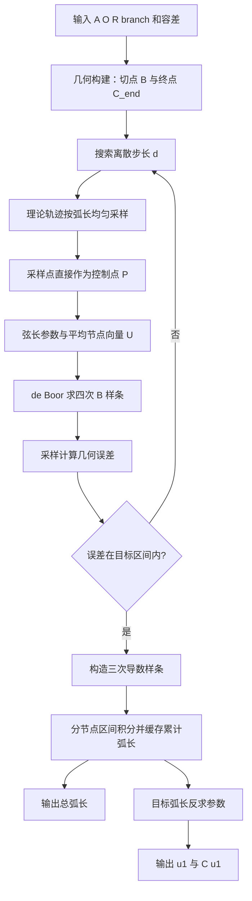
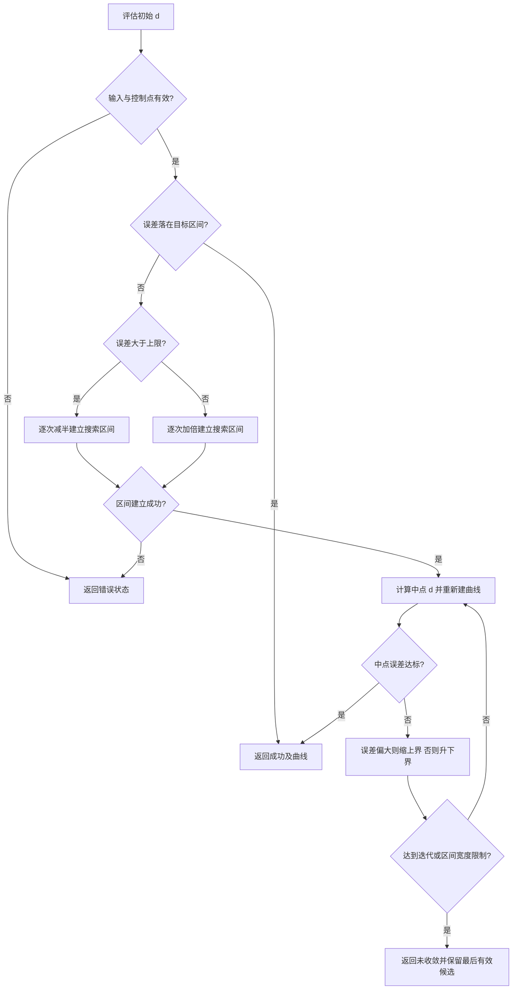
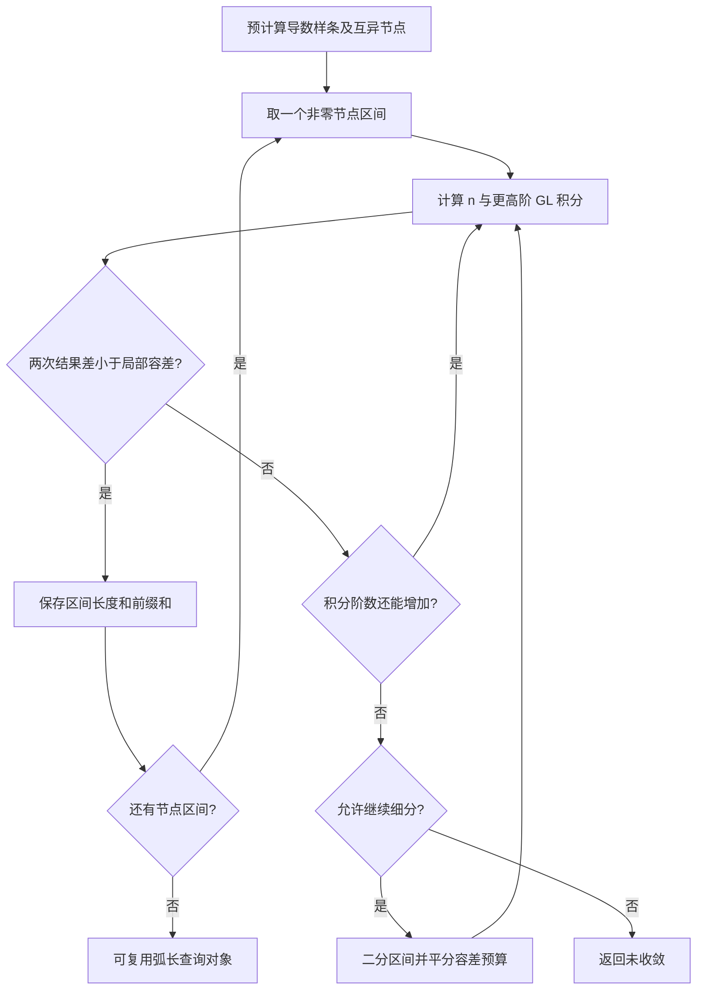
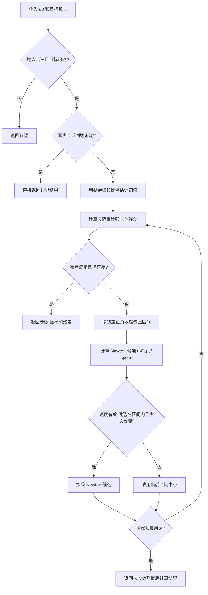

# 算法逻辑架构与 C 实现步骤

## 1. 输入、输出与整体架构

输入为起点 `A`、圆心 `O`、正半径 `R`、切点分支 `branch`，以及误差区间、初始离散步长、样条次数、误差采样数和积分容差。要求 `|A-O|>R`。

输出包括切点 `B`、终点 `C`、控制点 `P`、节点向量 `U`、采样最大误差、样条总弧长，以及从 `u0` 前进给定弧长后的 `u1` 和 `C(u1)`。

这里的 `C` 同时被原代码用于“终点”和“样条曲线”。下文把终点写作 `C_end`，曲线写作 `C(u)`，避免混淆。



整体分成“离线几何与曲线构造”和“可复用的弧长查询与反求”。原代码并未包含进给速度、加速度或 jerk 的时间规划，因此不能直接把输出称作具备动态约束的完整运动控制器。

## 2. 几何构造

令 `v=A-O`，`D=|v|`，`e=v/D`，`n=(-e_y,e_x)`。切点的径向向量为：

```text
ct = R / D
st = sqrt(1 - ct²)
rB = R * (ct*e + sign(branch)*st*n)
B = O + rB
AB = B - A
C_end = B + AB
L_line = |AB|
L_circle = 2πR
L_total = 2*L_line + L_circle
```

`branch>=0` 取正分支，否则取负分支。`C_end=2B-A`，所以 `A、B、C_end` 共线，且 `AB` 与 `BC_end` 等长。

理论路径按累计长度 `s` 分段：

```text
0 <= s <= L_line:
    X(s) = A + (s/L_line)*AB
L_line < s <= L_line + L_circle:
    θ = θ0 + direction*(s-L_line)/R
    X(s) = O + R*(cos θ, sin θ)
其他:
    X(s) = B + ((s-L_line-L_circle)/L_line)*AB
```

圆周方向需特别注意：`t_ccw=(-rB_y,rB_x)`。若要让入圆切向与 `AB` 同向，应选择 `direction=sign(dot(t_ccw,AB))`。原代码使用相反符号，因此入圆和出圆均发生方向折返。

本项目默认保留相反符号，保证能对照原始程序；传入 `tangent_continuous=1` 或使用 `--continuous` 才使用同向规则。对原始输入，`B=(0,-150)`，`C_end=(-500,-150)`。

## 3. 控制点与节点向量

先决定段数与实际间距：

```text
segments = max(1, ceil(L_total/d - 1e-12))
d_actual = L_total / segments
P_i = X(i*d_actual),  i=0..segments
```

`d` 是请求上限，实际采样间距是 `d_actual`。控制点数量为 `segments+1`，必须不少于 `p+1`。

注意：这些点直接充当控制点，算法没有求解插值方程或最小二乘拟合。夹持样条通过首末控制点，一般不经过所有内部控制点。

对控制点 `P_0..P_N`，弦长参数为：

```text
t_0 = 0
t_i = sum(k=1..i, |P_k-P_(k-1)|) / sum(k=1..N, |P_k-P_(k-1)|)
```

若总弦长低于 `1e-12`，改用均匀参数。节点总数为 `N+p+2`，两端各重复 `p+1` 次；内部节点按原公式平均：

```text
U_0..U_p = 0
U_(N+1)..U_(N+p+1) = 1
U_j = sum(t_(j-p)..t_(j-1)) / p, j=p+1..N
```

## 4. de Boor 求值与误差

二分查找节点区间 `k`，满足 `U_k<=u<U_(k+1)`；端点 `u=1` 专门选最后有效区间。取局部 `p+1` 个控制点，递推 `p` 层：

```text
d_j^(0) = P_(k-p+j)
α = (u-U_(k-p+j)) / (U_(k+j-r+1)-U_(k-p+j))
d_j^(r) = (1-α)*d_(j-1)^(r-1) + α*d_j^(r-1)
C(u) = d_p^(p)
```

分母不大于 `1e-12` 时按原逻辑令 `α=0`。C 版使用固定大小的局部数组，求值时不分配堆内存。每次求值复杂度约为 `O(log N+p²)`。

原误差度量：

```text
v = C_end-A
t = dot(P-A,v) / dot(v,v)        # 不夹紧到 [0,1]
Q_line = A+t*v
e_line = |P-Q_line|
e_circle = abs(|P-O|-R)
e(P) = min(e_line,e_circle)
e_sampled = max(e(C(u_i))), u_i 均匀分布在 [0,1]
```

因此误差对象是无限直线和整圆的并集，不是带运动顺序的路径距离。比如某个本应位于圆周阶段的点靠近直线，也会得到较小误差。若业务需要阶段保持、有限线段距离或 Hausdorff 距离，应另定义误差函数，不能只改名称。

## 5. d 的搜索逻辑



保留原搜索决策用于可比性，但它依赖“更密的点通常降低误差”的经验关系，不具备全局单调性证明。`ceil` 使曲线在同一段数对应的整个 `d` 区间内不变；窄目标区间可能完全不可达。C 版不返回“警告后照常成功”，而是用 `BS_NOT_CONVERGED` 区分候选与达标结果。

## 6. 导数、积分与缓存

四次样条的导数是三次样条：

```text
Q_i = p*(P_(i+1)-P_i) / (U_(i+p+1)-U_(i+1)), i=0..N-1
U_derivative = U[1:-1]
speed(u) = |C'(u)|
S(u) = integral(domain_start..u, speed(t) dt)
```

按有效域 `U[p]..U[count]` 中互异节点拆分区间。每个区间使用 `n` 与 `2n` 点的高斯–勒让德公式：

```text
I_n(a,b) = (b-a)/2 * sum(w_i * speed((a+b)/2 + (b-a)/2*x_i))
estimate = abs(I_2n-I_n)
```

节点是 Legendre 多项式的根，C 版用 Newton 求根并重新计算权重，最多 256 点。若阶数到达上限仍未满足估计容差，递归细分区间，两侧各分配一半容差；细分深度最多 24。达到资源限制仍未收敛就返回 `BS_NOT_CONVERGED`。



### 原缓存与 C 缓存的区别

原 `BSplineArcLength` 把任意查询参数插入有序列表，从最近左缓存点继续积分。每段独立使用同样的 `err`，所以累计误差随查询历史传播；后插入的点也不会修订已存在的右侧前缀值。每次列表查找和插入还需要 `O(M)` 操作。

C 版初始化时固定计算各节点区间长度，保存不可变 `breaks[]` 和 `prefix[]`。查询 `u` 时二分找到所在区间，用“该节点前缀 + 当前部分区间积分”，结果不依赖查询顺序。初始化时给完整区间积分分配总容差的一半，余下一半用于查询部分区间。任意区间长度通过两个前缀之差得到，误差估计预算最多约为两次累计查询的预算之和。

这仍是基于数值估计的预算，不构成严格上界；极短区间使用大前缀相减也可能受到浮点消减影响。连续使用时应选择远小于插补长度的合理积分容差。

## 7. 弧长反求

求解：`F(u)=S(u)-S(u0)-L_target=0`，导数 `F'(u)=speed(u)`。



每步更新包围区间；速度低于 `1e-12`、候选非有限、越界或步长超过当前区间宽度的 75% 时使用二分。与原代码“Newton 失败后从整段重新二分”相比，这样能复用已收缩区间。

负弧长作为非法输入，零弧长返回原点；目标距离末端在外层容差内时返回末端。不得将反求成功理解成绝对精确，返回的 `abs_error` 是相对于当前数值积分值的残差，独立精度由验证程序另行检查。

## 8. Python 与 C 对应关系

| Python | C API | 数据 |
|---|---|---|
| `build_trajectory_geometry` | `bs_geometry` | `BsGeometry` |
| `generate_trajectory_points` | `bs_sample` | `BsCurve.points` |
| `generate_knot_vector` | `bs_knots` | `BsCurve.knots` |
| `find_span`, `de_boor` | `bs_eval` | 局部固定数组 |
| `project_to_theoretical` | `bs_theoretical_error` | 直线与圆距离 |
| `evaluate_error_for_d` | `bs_sample` + `bs_max_error` | 候选曲线 |
| `fit_bspline_by_bisection` | `bs_fit` | `BsFit` |
| `compute_derivative_curve` | `bs_derivative` | 低一次导数曲线 |
| `arc_length_bspline_gauss` | `bs_arc_init` | `BsArc.prefix[spans]` |
| `BSplineArcLength.cumulative` | `bs_arc_cumulative` | 固定节点前缀缓存 |
| `arc_length_between`, `.length` | `bs_arc_length` | 非负区间长度 |
| 最后一个 `find_u_by_arc_length` | `bs_inverse` | `BsInverse` |
| `plot_results` | `python/plot.py` | 读取 C JSON 输出 |

原脚本中后定义的同名 `find_u_by_arc_length` 会覆盖前面的纯二分版本；整理后的 Python 参考保留实际生效的 Newton + 二分版本。去掉重复导入、重复定义和绘图阻塞，数值公式保持可对照。

## 9. 可复用的实现步骤

1. 明确几何约定与误差对象，先决定使用原方向还是切向连续方向。
2. 用 `BsGeometry` 保存固定几何数据，验证半径、起点位置和有限数值。
3. 根据 `d` 分配控制点和节点向量，限制最多一百万控制点，检查内存分配。
4. 用固定局部数组实现 de Boor，再用解析直线和端点检查下标。
5. 构建误差评估与 `d` 搜索，明确区分成功、未收敛与资源不足。
6. 构造导数样条，将积分与几何模块分离。
7. 分节点区间积分并建立固定前缀缓存，加入达限细分与失败返回。
8. 用带区间保护的 Newton 反求参数，保留残差和迭代统计。
9. 先运行 C 解析测试，再对照原 Python，最后使用独立 SciPy 样条、QUADPACK 积分和 Brent 求根校验。
10. 保存具体输入、环境、容差和误差到 JSON 报告，用 CI 重复验证后再用于目标平台。

C 对象拥有的堆内存均通过对应 `*_free` 释放。弧长对象不含可变全局状态；在创建后不修改曲线及对象时，可用于独立的只读查询。初始化和反求可能进行多次积分与内存分配；本项目没有验证实时调度延迟或最坏执行时间，不应直接宣称为硬实时插补实现。
